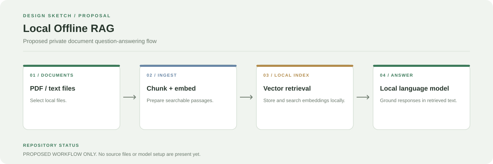

# Local Offline RAG System

This repository is currently empty. It does not yet contain an executable RAG pipeline or model configuration.

## Intended direction

Build a local-first question-answering system that retrieves relevant passages from user-provided documents and supplies those passages to a local language model.

## Proposed workflow

1. Read local documents.
2. Split them into searchable chunks.
3. Create embeddings with a local embedding model.
4. Store vectors in a local index.
5. Retrieve relevant chunks for each question.
6. Generate an answer using a local model and show the supporting context.

## Suggested first milestone

Start with PDF/TXT ingestion, a small local embedding model, a simple vector store, and a command-line test before adding a user interface.

All items above are a roadmap. They are not features available in the current repository.
