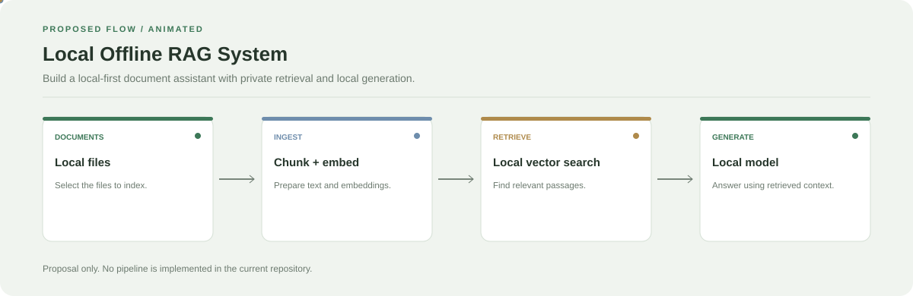

# Local Offline RAG System

**A proposed local-first document assistant architecture.**

[](https://github.com/chyk2468/Local-Offline-RAG-System)

## 1. Project Title & Tagline

A proposed local-first document assistant architecture.

## 2. Problem Statement

Personal documents may contain sensitive information. A local retrieval workflow could help users search their own files without sending document content to external services.

## 3. Project Preview

This repository is currently a placeholder. Add a real screenshot only after a working application has been implemented.

[Open interactive architecture](architecture.html)

## 4. Overview

**Status: proposal only.** The repository does not yet contain a runnable document ingestion, retrieval, or generation pipeline. The diagram describes a possible future design.

## 5. Key Features

- Proposed local document ingestion.
- Proposed chunking and local embeddings.
- Proposed local vector retrieval.
- Proposed answer generation with a locally hosted model.

## 6. Architecture / Workflow



Open the [interactive architecture explorer](architecture.html) to inspect each proposed stage.

## 7. Tech Stack

Not implemented yet. A possible baseline is Python, local embeddings, a local vector index, and a GGUF-compatible language model.

## 8. Installation & Setup

```bash
git clone https://github.com/chyk2468/Local-Offline-RAG-System.git
cd Local-Offline-RAG-System
```

There is no runnable application or dependency setup yet.

## 9. Usage

No working application is available. Start with a tested document loader and a query that returns relevant source excerpts before adding generation.

## 10. Project Structure

Proposed layout: `src/`, `tests/`, `data/`, `README.md`, and a dependency file.

## 11. Results & Demo

No implementation results are available yet because the repository is currently a placeholder.

## 12. Future Enhancements

- Implement document loading and tests.
- Add chunking and local embeddings.
- Build a searchable index.
- Return source excerpts for each query.
- Add grounded generation after retrieval works reliably.

## 13. License

Add a LICENSE file before granting reuse or redistribution permissions.
